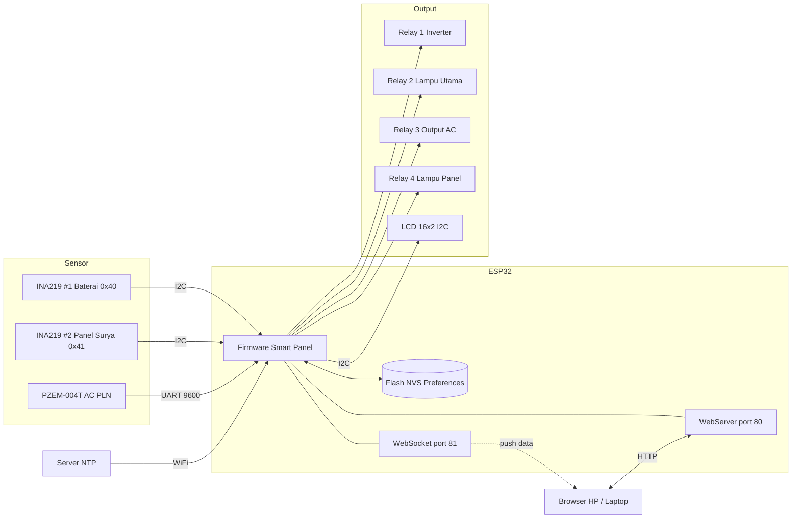
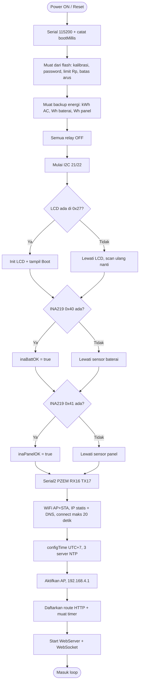
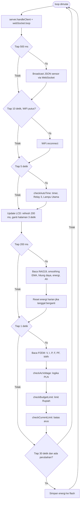
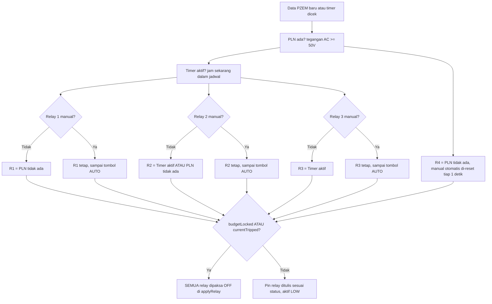
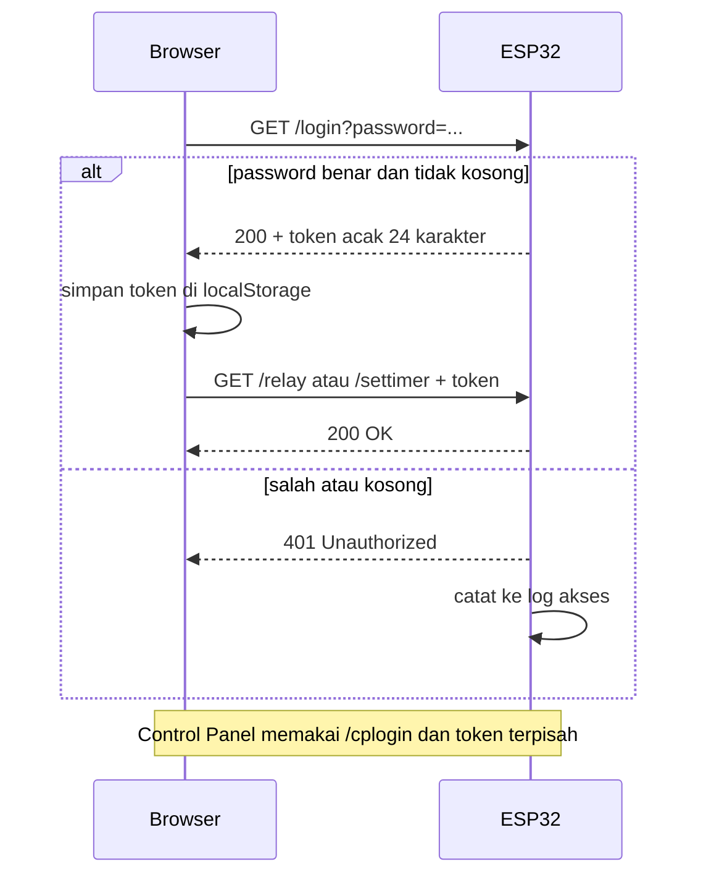
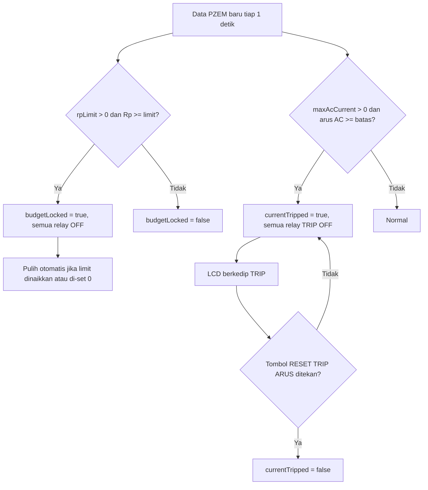

# ☀️ Smart Panel PLTS — ESP32 Solar Monitor & Controller

Sistem **monitoring dan kontrol PLTS (Pembangkit Listrik Tenaga Surya)** berbasis **ESP32**. Satu board ESP32 membaca data baterai, panel surya, dan listrik PLN, menampilkannya di **web dashboard** (disajikan langsung oleh ESP32) dan **LCD 16x2**, serta mengontrol **4 relay** secara otomatis (berdasarkan ada/tidaknya PLN dan jadwal timer) maupun manual.

> ⚠️ **PERINGATAN KESELAMATAN** — Proyek ini menyambungkan **tegangan AC PLN** lewat relay dan berhubungan dengan baterai & panel surya. Salah wiring bisa menyebabkan kebakaran, kerusakan alat, atau bahaya nyawa. Kerjakan hanya jika paham kelistrikan, gunakan MCB/sekering yang sesuai, dan **gunakan dengan risiko sendiri** (lihat [LICENSE](LICENSE)).

---

## 📑 Daftar Isi

1. [Fungsi Proyek](#-fungsi-proyek)
2. [Fitur](#-fitur)
3. [Kebutuhan Hardware](#-kebutuhan-hardware)
4. [Wiring / Pin](#-wiring--pin)
5. [Library yang Dibutuhkan](#-library-yang-dibutuhkan)
6. [⚙️ Yang WAJIB Diisi Sebelum Upload](#️-yang-wajib-diisi-sebelum-upload)
7. [Cara Install & Upload](#-cara-install--upload)
8. [Cara Mengakses Web](#-cara-mengakses-web)
9. [Diagram Alur Kerja](#-diagram-alur-kerja)
10. [Logika Relay](#-logika-relay)
11. [Proteksi (Limit Biaya & Over-Current)](#️-proteksi)
12. [Penjelasan Perhitungan](#-penjelasan-perhitungan)
13. [Tampilan LCD](#-tampilan-lcd-16x2)
14. [Endpoint HTTP / API](#-endpoint-http--api)
15. [Data yang Disimpan di Flash](#-data-yang-disimpan-di-flash-nvs)
16. [Catatan Keamanan](#-catatan-keamanan)
17. [Keterbatasan yang Perlu Diketahui](#-keterbatasan-yang-perlu-diketahui)
18. [Troubleshooting](#-troubleshooting)
19. [Lisensi & Kredit](#-lisensi--kredit)

---

## 🎯 Fungsi Proyek

Smart Panel PLTS dibuat untuk sistem surya skala kecil (contoh di kode: baterai **LiFePO4 4S 12.8V 30Ah**) yang bekerja berdampingan dengan listrik PLN. Fungsinya:

- **Memantau** tegangan, arus, daya, dan energi baterai serta panel surya (sensor INA219), dan data listrik AC PLN (sensor PZEM-004T).
- **Mengontrol** 4 relay: Inverter, Lampu Utama, Output AC, dan Lampu Panel.
- **Otomatis** menyalakan inverter & lampu saat PLN padam, dan menjalankan jadwal timer harian.
- **Melindungi** instalasi lewat limit biaya listrik (Rupiah) dan batas arus AC maksimal (trip seperti MCB).
- **Menampilkan** semua data di dashboard web yang bisa dibuka dari HP/laptop, dan di LCD 16x2 di panel.

## ✨ Fitur

**Monitoring**
- Baterai: tegangan, arus, daya, level (% SOC kurva LiFePO4), energi hari ini (Wh), kapasitas (Wh), estimasi sisa waktu pakai.
- *Coulomb counting*: Ah terpakai (discharge) & Ah terisi (charge) untuk mengukur **kapasitas asli baterai**.
- Panel surya: tegangan, arus, daya, energi hari ini (Wh).
- AC/PLN (PZEM-004T): tegangan, arus, daya, frekuensi, power factor, energi (kWh), dan estimasi biaya (Rupiah).
- Jam real-time dari NTP (zona WIB, UTC+7).

**Kontrol**
- 4 relay dengan mode **AUTO** dan **MANUAL** (toggle di web, perlu login).
- Timer jadwal otomatis (jam mulai & selesai, bisa melewati tengah malam).
- Tombol "KEMBALI KE AUTO" per relay.

**Proteksi**
- **Limit biaya (Rp)**: saat biaya listrik mencapai limit, semua relay dikunci OFF.
- **Batas arus AC maksimal**: saat terlampaui, semua relay **TRIP OFF** dan tetap OFF sampai direset manual (perilaku seperti MCB).

**Admin & Keamanan**
- Dua password terpisah: **LOGIN** (kontrol relay & timer) dan **Control Panel** (pengaturan sistem).
- Log akses login (20 entri terakhir) dengan IP & waktu.
- Kalibrasi tegangan baterai 17 titik (lookup table) dan faktor kalibrasi panel.

**Ketahanan (anti-macet)**
- Deteksi LCD & INA219 sebelum dipakai (tidak hang kalau tidak terpasang), LCD bisa *hot-plug*.
- Auto-reconnect WiFi tiap 10 detik jika putus.
- Backup energi (kWh, Wh baterai, Wh panel) ke flash, jadi angka tidak balik 0 saat ESP restart.
- NTP dengan 3 server cadangan dan jeda retry agar `loop()` tidak terblokir.
- Mode WiFi ganda: **STA** (WiFi rumah, IP statis) + **AP** (hotspot ESP32 sendiri).

## 🧰 Kebutuhan Hardware

| Komponen | Jumlah | Keterangan |
|---|---|---|
| ESP32 (DevKit) | 1 | Board utama |
| Modul relay 4 channel | 1 | **Aktif LOW** (LOW = relay ON) |
| PZEM-004T v3.0 | 1 | Sensor listrik AC, komunikasi UART (9600) |
| INA219 | 2 | #1 baterai alamat `0x40`, #2 panel surya alamat `0x41` (jumper A0 → VCC) |
| LCD 16x2 I2C | 1 | Alamat `0x27` (atau `0x3F`) — opsional |
| Baterai LiFePO4 4S | 1 | Contoh: 12.8V 30Ah |
| Panel surya + SCC | 1 | Sesuai kebutuhan |
| Inverter | 1 | Dikontrol Relay 1 |
| MCB/sekering, kabel | — | Wajib untuk keselamatan |

## 🔌 Wiring / Pin

| Fungsi | Pin ESP32 |
|---|---|
| Relay 1 — Inverter | GPIO **26** |
| Relay 2 — Lampu Utama | GPIO **27** |
| Relay 3 — Output AC | GPIO **14** |
| Relay 4 — Lampu Panel | GPIO **13** |
| PZEM RX (ESP32 menerima) | GPIO **16** |
| PZEM TX (ESP32 mengirim) | GPIO **17** |
| I2C SDA (LCD + 2× INA219) | GPIO **21** |
| I2C SCL (LCD + 2× INA219) | GPIO **22** |

**Catatan wiring INA219 baterai:** `VIN+` ke kutub (+) baterai, `VIN-` ke (+) beban. Dengan begitu arus **positif = discharge** (ke beban) dan **negatif = charging**. Seluruh logika di kode mengikuti konvensi ini.

Semua device I2C berbagi satu bus (21/22) karena alamatnya unik: LCD `0x27`, INA219 `0x40` & `0x41`.

## 📚 Library yang Dibutuhkan

Install lewat **Arduino IDE → Library Manager**:

| Library | Penulis |
|---|---|
| `WebSockets` | Markus Sattler |
| `PZEM004Tv30` | Jakub Mandula |
| `LiquidCrystal I2C` | Frank de Brabander |
| `Adafruit INA219` | Adafruit (otomatis meminta *Adafruit BusIO*) |

Library bawaan ESP32 core (tidak perlu install): `WiFi`, `WebServer`, `Preferences`, `Wire`, `time`.

Board: **ESP32 Arduino Core** (Boards Manager → `esp32` by Espressif).

## ⚙️ Yang WAJIB Diisi Sebelum Upload

Di file `.ino` ini data pribadi **sengaja dikosongkan**. Isi bagian berikut sebelum upload:

| Variabel | Lokasi | Isi dengan |
|---|---|---|
| `ssid` | Bagian `WIFI` | Nama WiFi rumah/tempatmu |
| `pass` | Bagian `WIFI` | Password WiFi tersebut |
| `ap_ssid` | Bagian `WIFI` | Nama hotspot ESP32 (boleh dibiarkan default) |
| `ap_pass` | Bagian `WIFI` | Password hotspot ESP32, **minimal 8 karakter** (kosong = hotspot terbuka tanpa password) |
| `STA_LOCAL_IP` | Bagian `WIFI` | IP statis ESP32 di jaringanmu (di luar range DHCP router) |
| `STA_GATEWAY` | Bagian `WIFI` | IP router/gateway |
| `STA_SUBNET` | Bagian `WIFI` | Biasanya `255.255.255.0` |
| `STA_DNS1` / `STA_DNS2` | Bagian `WIFI` | DNS (router dan/atau `8.8.8.8`). **Wajib benar**, kalau tidak NTP/timer gagal |
| `LOGIN_PASSWORD` | `ADMIN LOGIN` | Password tombol LOGIN (kontrol relay & timer) |
| `CP_PASSWORD` | `CONTROL PANEL` | Password Control Panel (**beda** dari LOGIN) |
| `TUNNEL_URL_SOURCE` | JavaScript di `handleRoot()` | *Opsional.* URL file `tunnel-url.txt` di GitHub-mu, hanya jika web diakses dari internet lewat tunnel |
| `TARIFF_PER_KWH` | Bagian `PIN` | Tarif listrik PLN (Rp/kWh), default `1352.0` |
| `BATT_CAPACITY_AH` | Bagian `DATA SENSOR DC` | Kapasitas baterai (Ah), default `30.0` |
| `SOC_LUT_V` / `SOC_LUT_PCT` | Bagian `KURVA SOC` | Sesuaikan jika baterai bukan LiFePO4 4S |
| `LCD_ADDR` | Bagian `OBJECT` | `0x27` atau `0x3F` sesuai LCD-mu |
| `autoStartH/M`, `autoEndH/M` | Bagian `AUTO TIMER` | Jadwal timer default (bisa diubah dari web) |

> 🔐 **Password kosong ditolak.** Kode sudah dijaga: jika `LOGIN_PASSWORD` atau `CP_PASSWORD` masih kosong, login selalu ditolak. Jadi **kamu harus mengisinya** sebelum bisa memakai kontrol relay & Control Panel. Password bisa diganti kemudian dari Control Panel (disimpan di flash).

> ❗ **Jangan pernah commit** SSID, password WiFi, dan password admin aslimu ke GitHub.

## 🚀 Cara Install & Upload

1. Install **Arduino IDE** dan tambahkan board **ESP32**.
2. Install semua [library](#-library-yang-dibutuhkan).
3. Rakit hardware sesuai [wiring](#-wiring--pin).
4. Buka file `.ino`, isi [konfigurasi wajib](#️-yang-wajib-diisi-sebelum-upload).
5. Pilih board ESP32 yang sesuai (mis. *ESP32 Dev Module*) dan port yang benar.
6. Upload, lalu buka **Serial Monitor** (115200 baud) untuk melihat log boot.
7. Pastikan log menampilkan WiFi terhubung, `[NTP] Sync berhasil!`, dan sensor terdeteksi.

## 🌐 Cara Mengakses Web

| Cara | Alamat |
|---|---|
| Lewat WiFi rumah (STA) | `http://<STA_LOCAL_IP>` |
| Lewat hotspot ESP32 (AP) | Sambung ke WiFi `ap_ssid`, buka `http://192.168.4.1` |
| Dari internet (opsional) | Lewat tunnel (mis. Cloudflare Tunnel), alamat tunnel ditulis di file `tunnel-url.txt` di GitHub |

Dashboard punya 4 tab:

| Tab | Isi | Login |
|---|---|---|
| **MONITORING** | Semua data sensor real-time | Tidak perlu |
| **KONTROL** | Timer & toggle 4 relay | Tombol **LOGIN** (header) |
| **CONTROL PANEL** | Status sistem, password, kalibrasi, limit biaya, max arus, log akses | Password **Control Panel** |
| **TENTANG WEB** | Penjelasan sistem & info pengembang | Tidak perlu |

Cara kerja koneksi di web: kalau halaman dibuka dari alamat lokal (`192.168.x.x`, `10.x.x.x`, `172.16–31.x.x`, `localhost`), web memakai ESP32 langsung tanpa internet. Kalau dibuka dari alamat lain, web mengambil URL tunnel dari `TUNNEL_URL_SOURCE`. Data diperbarui lewat polling HTTP `/data` tiap 500 ms.

> Font dashboard dimuat dari Google Fonts, jadi perangkat yang membuka web perlu internet agar tampilan font sempurna. Tanpa internet, dashboard tetap berfungsi dengan font bawaan.

## 🔄 Diagram Alur Kerja

### 1. Arsitektur sistem

### 2. Alur boot (`setup()`)

### 3. Alur utama (`loop()`)

### 4. Penentuan status fisik relay

### 5. Alur login & otorisasi

### 6. Alur proteksi

## 🔁 Logika Relay

| Relay | Nama | Logika AUTO | Perilaku manual |
|---|---|---|---|
| **R1** | Inverter | **ON** saat PLN tidak ada (< 50V), **OFF** saat PLN ada (≥ 50V) | Bertahan sampai tombol **AUTO** ditekan |
| **R2** | Lampu Utama | **ON** jika timer aktif **ATAU** PLN tidak ada | Bertahan sampai tombol **AUTO** ditekan |
| **R3** | Output AC | **ON** selama jam timer aktif (tidak dipengaruhi PLN) | Bertahan sampai tombol **AUTO** ditekan |
| **R4** | Lampu Panel | **ON** saat PLN tidak ada, **OFF** saat PLN ada | Hanya **sesaat**, PZEM menimpa kembali dalam ±1 detik |

Catatan:
- Batas PLN dianggap ada: `AC_PLN_ADA = 50.0` V.
- Timer default **18:00–21:00**, mendukung jadwal yang melewati tengah malam (mis. 22:00–05:00).
- Timer baru berjalan setelah **NTP berhasil sinkron**. Kalau NTP gagal, Output AC dan bagian timer Lampu Utama tidak berjalan.
- ⚠️ Jika PZEM **tidak terbaca / terlepas**, tegangan AC dianggap 0V sehingga PLN dianggap *tidak ada* — Inverter, Lampu Utama, dan Lampu Panel akan ON otomatis. Pastikan wiring PZEM benar.

## 🛡️ Proteksi

**Limit Biaya (Rupiah)** — diatur di Control Panel → LIMIT BIAYA.
- Biaya = `kWh PZEM × TARIFF_PER_KWH`.
- Jika biaya ≥ limit, semua relay dikunci OFF (manual maupun auto).
- Pulih otomatis saat limit dinaikkan di atas biaya saat ini, atau di-set `0` (nonaktif).
- Nilai limit tersimpan di flash.

**Batas Arus AC Maksimal (Over-Current Trip)** — Control Panel → MAX ARUS.
- Jika arus AC ≥ batas, semua relay **TRIP OFF**.
- Relay **tetap OFF** walau arus sudah turun; harus tekan **RESET TRIP ARUS** (meniru MCB).
- LCD menampilkan peringatan `!! TRIP !!` berkedip menggantikan semua halaman data.
- Nilai batas tersimpan di flash, tetapi **status trip tidak** (setelah restart ESP32, status trip kembali normal dan dievaluasi ulang).

## 🧮 Penjelasan Perhitungan

- **Level baterai (SOC):** interpolasi tabel kurva LiFePO4 4S (bukan linear, karena kurva LFP sangat datar di tengah). Cutoff 0% = 10.0V, 100% = 14.6V. Tabel bisa disesuaikan di `SOC_LUT_V` / `SOC_LUT_PCT`.
- **Kalibrasi tegangan baterai:** lookup table 17 titik (`BATT_LUT_WEB` → `BATT_LUT_AVO`), default **passthrough** (tanpa koreksi). Isi dari Control Panel → KALIBRASI jika INA219-mu selisih konsisten dengan multimeter. Titik otomatis diurutkan menaik.
- **Smoothing:** pembacaan INA219 di-*EMA* (`85% lama + 15% baru`) agar tidak melompat.
- **Noise floor arus:** arus < 0.01 A dibulatkan menjadi 0 (menghilangkan angka "hantu" `-0.00A`).
- **Energi Hari Ini (Baterai):** hanya menghitung energi yang **masuk** (charging, daya negatif). **Energi Hari Ini (Panel):** akumulasi daya panel. Keduanya reset pada pergantian tanggal (00:00) dan dibackup ke flash.
- **Kapasitas baterai (Wh):** `BATT_CAPACITY_AH × tegangan baterai saat ini`.
- **Estimasi sisa baterai:** `(Ah × V × SOC%) / daya discharge × 60` menit, hanya dihitung saat discharge > 0.5 W. Selain itu tampil "Charging / Idle".
- **Coulomb counting (Ah):** integral arus terhadap waktu. `Ah Terpakai` (discharge) dan `Ah Terisi` (charge) sengaja **hanya di RAM** agar mulai dari 0 setiap tombol RESET fisik ditekan.
  - Cara cek kapasitas asli: charge sampai 100% → tekan RESET fisik ESP32 → pakai baterai sampai habis → angka **Ah Terpakai** = kapasitas asli.
- **Workaround panel surya:** jika arus panel = 0, tegangan panel dipaksa 0 V untuk menutupi tegangan "nyangkut" akibat leakage. Solusi permanennya: dioda Schottky seri di `VIN-` ke PV+ SCC dan resistor pull-down 100k dari `VIN+` ke GND, lalu baris workaround boleh dihapus.
- **Backup kWh AC:** nilai kWh asli ada di memori internal PZEM; ESP32 membackup ke flash tiap 30 detik (jika berubah ≥ 0.001 kWh / 0.5 Wh) supaya tidak tampil 0 saat restart ketika PZEM sedang mati.

## 📟 Tampilan LCD 16x2

Halaman berganti otomatis tiap **3 detik**, angka di-refresh tiap **200 ms**. Total **15 halaman**:

| # | Isi |
|---|---|
| 0 | Tegangan, % baterai, estimasi sisa waktu |
| 1 | Arus, daya, energi hari ini, kapasitas Wh baterai |
| 2 | Tegangan panel surya |
| 3 | Arus, daya, energi panel |
| 4 | Tegangan & frekuensi AC |
| 5 | Arus, daya, power factor AC |
| 6 | Energi kWh & biaya Rupiah |
| 7 | Status limit biaya |
| 8 | Status batas arus AC |
| 9 | Status Relay 1 & 2 |
| 10 | Status Relay 3 & 4 |
| 11 | Jadwal timer & statusnya |
| 12 | Ah discharge / Ah charge |
| 13 | IP WiFi (STA) |
| 14 | IP Access Point |

Saat **TRIP** aktif, seluruh halaman diganti peringatan berkedip `!! TRIP !!`.

## 🔗 Endpoint HTTP / API

| Endpoint | Auth | Fungsi |
|---|---|---|
| `/` | — | Halaman dashboard (dikirim bertahap/chunked) |
| `/data` | — | JSON semua data sensor & status |
| `/login?password=` | — | Login kontrol relay/timer, mengembalikan token |
| `/cplogin?password=` | — | Login Control Panel, mengembalikan token |
| `/relay?r=1..4&s=0\|1\|auto&token=` | token LOGIN | Toggle relay / kembali ke AUTO |
| `/settimer?start_h&start_m&end_h&end_m&token=` | token LOGIN | Atur jadwal timer |
| `/admin/status` | token CP | Uptime, heap, RSSI, IP |
| `/admin/setpassword` | token CP | Ganti password LOGIN |
| `/admin/setcppassword` | token CP | Ganti password Control Panel |
| `/admin/getcal`, `/admin/setcal` | token CP | Baca / simpan kalibrasi |
| `/admin/getbudget`, `/admin/setbudget` | token CP | Baca / set limit biaya |
| `/admin/getmaxcurrent`, `/admin/setmaxcurrent` | token CP | Baca / set batas arus |
| `/admin/resetcurrent` | token CP | Reset trip arus |
| `/admin/logs` | token CP | Log akses login |

WebSocket di **port 81** mengirim JSON yang sama dengan `/data` tiap 500 ms (satu arah ESP32 → klien). Dashboard bawaan memakai polling HTTP, jadi WebSocket ini tersedia untuk integrasi sendiri.

## 💾 Data yang Disimpan di Flash (NVS)

| Namespace | Isi |
|---|---|
| `timer` | Jadwal timer (jam/menit mulai & selesai) |
| `admin` | Password LOGIN & Control Panel, kalibrasi 17 titik, faktor panel, limit Rupiah, batas arus |
| `energy` | Backup kWh AC, Wh baterai hari ini, Wh panel hari ini |

**Tidak disimpan (RAM saja):** status relay manual/auto, status trip arus, token login, log akses, Ah discharge/charge.

## 🔐 Catatan Keamanan

Proyek ini ditujukan untuk jaringan lokal/hobi. Sebelum dipakai serius atau dibuka ke internet, perhatikan:

- Komunikasi memakai **HTTP polos** (tanpa HTTPS), password dan token dikirim lewat **query string** URL.
- Token login tidak punya masa kedaluwarsa dan hanya ada satu sesi aktif per jenis login.
- Endpoint `/admin/status` mengembalikan password LOGIN & Control Panel dalam **teks biasa** ke yang sudah login Control Panel. Pertimbangkan menghapus field `loginPassword` dan `cpPassword` dari fungsi `handleAdminStatus()`.
- Header CORS diset `*` (semua origin).
- Gunakan password yang kuat, ganti default, dan jangan expose langsung ke internet tanpa lapisan tambahan (VPN, Cloudflare Access, dll).

## ⚠️ Keterbatasan yang Perlu Diketahui

- `Adafruit_INA219.begin()` memakai kalibrasi bawaan (32V, 2A) dengan shunt 0.1 Ω di modul standar, sehingga rentang arus terbatas (sekitar 3.2 A). Untuk arus lebih besar, pakai shunt lebih kecil dan ubah kalibrasi INA219.
- INA219 maksimal 26V pada bus (32V absolut), pastikan tegangan panel surya (open circuit) tidak melebihi batas modul.
- HTML dashboard sekitar 77 KB dikirim bertahap; RAM ESP32 terbatas, hindari menambah halaman terlalu besar.
- Zona waktu tetap **UTC+7 (WIB)**; ubah di `configTime(7 * 3600, ...)` untuk zona lain.
- Data AC (V/I/P/F/PF) di-nol-kan jika PZEM tidak terbaca; hanya kWh yang dipertahankan.

## 🛠️ Troubleshooting

| Masalah | Penyebab & solusi |
|---|---|
| Timer tidak jalan / `[NTP] Gagal sync` | DNS tidak diisi atau salah. Isi `STA_DNS1`/`STA_DNS2` dan pastikan WiFi punya internet |
| WiFi tersambung tapi web tidak terbuka | IP statis/gateway tidak cocok dengan jaringanmu. Cek subnet router |
| LCD blank atau kotak-kotak | Ganti `LCD_ADDR` `0x27` ↔ `0x3F`, atur kontras potensiometer LCD |
| INA219 tidak terdeteksi | Cek wiring SDA/SCL, alamat (`0x40`/`0x41`), jumper A0 untuk sensor #2. Gunakan I2C scanner |
| Login selalu gagal | `LOGIN_PASSWORD` / `CP_PASSWORD` belum diisi di kode (password kosong ditolak) |
| Relay terbalik (ON saat seharusnya OFF) | Modul relay-mu aktif HIGH; ubah logika `LOW`/`HIGH` di `applyRelay()` |
| Inverter menyala terus | PZEM tidak terbaca (dianggap PLN mati). Cek wiring RX/TX PZEM |
| Arus baterai tandanya terbalik | Wiring `VIN+`/`VIN-` INA219 tertukar |
| kWh/Rp tiba-tiba 0 | PZEM belum merespons setelah restart; angka backup flash akan tampil sampai PZEM terbaca |
| Semua relay mati terus | Limit biaya tercapai atau trip arus aktif (cek banner di tab Kontrol) |

## 📄 Lisensi & Kredit

Dirilis di bawah lisensi **MIT**, lihat berkas [LICENSE](LICENSE).

Dibuat oleh **Moh Hilmi Mulia Rahardyan** — SMKN 1 Singosari, Team MP (Minions Project).

Kontribusi, issue, dan pull request sangat diterima. ⭐ Beri bintang jika proyek ini bermanfaat!
